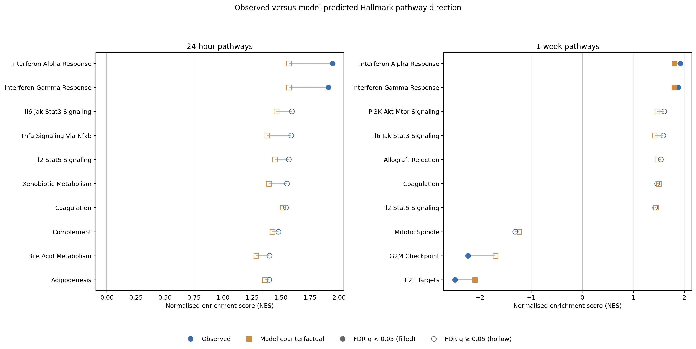
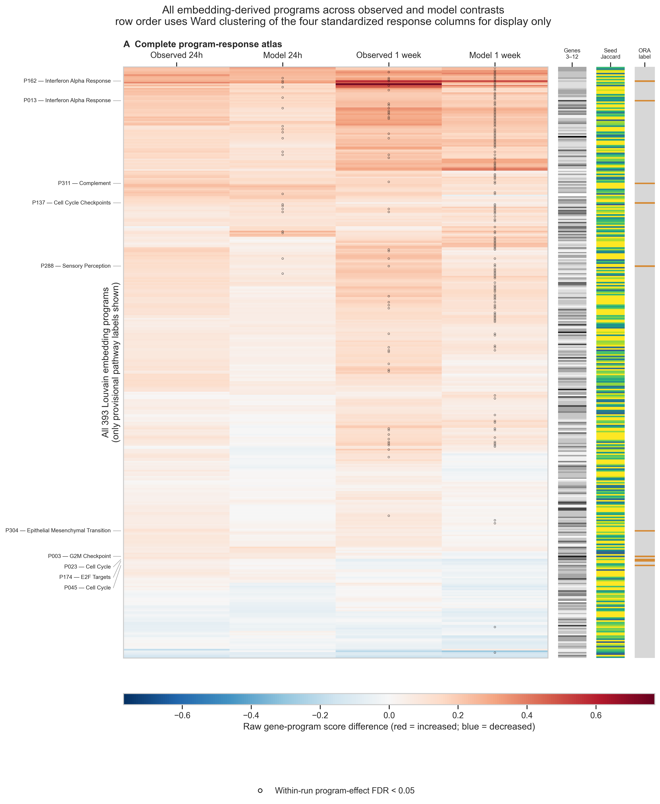

# MSc Project Perturbation Prediction Glioblastoma Radiotherapy

Research code for predicting radiotherapy-associated transcriptional responses
in glioblastoma. The repository contains four workflows: **scGPT training**,
**scGenePT training**, **attention extraction** and **embedding analysis**.

The project scripts were run on the **UCL Myriad cluster**. The supplied batch
jobs use Sun Grid Engine (`qsub`), UCL software modules and the recorded Python
environments. Start with the [Myriad setup guide](docs/SETUP.md).

## Project structure

| Folder | Contents |
|---|---|
| [scgpt](scgpt/) | scGPT training code, Myriad job, requirements and June 28 checkpoint metadata |
| [scgenept](scgenept/) | scGenePT training, configurable gene-language embeddings, Myriad job and July 11 checkpoint metadata |
| [attention_extraction](attention_extraction/) | One launcher for scGPT/scGenePT attention extraction and a Myriad submission script |
| [embedding_analysis](embedding_analysis/) | scGPT checkpoint embedding analysis, gene programs, pathway enrichment, Reactome-only analysis and saved outputs |

Supporting files are in [environments](environments/) (the compact Myriad
environment guide and exact package records) and [docs](docs/) (setup,
checkpoint downloads and provenance).

## Getting started

1. Follow [Myriad setup](docs/SETUP.md) to place the code in the expected working
   directories and select the corresponding [environment](environments/README.md).
2. Obtain the official scGPT/scGenePT software and model assets described there.
3. For checkpoint analyses, restore the weights from the
   [checkpoint release](docs/CHECKPOINTS.md) and supply the required study inputs.
4. Submit the selected training or attention job with `qsub`. The embedding
   guides explain the analysis run order and path settings for Myriad.

## Selected outputs

### Observed and model pathway responses

### Embedding-derived gene programs

Saved figures and aggregate tables are provided for inspection. They are existing
research outputs; repository preparation did not rerun the analyses. Embedding
similarity networks and attention summaries are descriptive model analyses.

## Data and reproducibility

Raw and formatted study datasets, cell metadata and prediction arrays are
excluded. Notebook execution outputs are cleared. See [data availability](DATA_AVAILABILITY.md).
The package records describe the inspected Myriad model environments. A fresh
installation has not been tested during repository preparation; the
[environment guide](environments/README.md) explains their scope and the
additional embedding-analysis requirements.

Training and model-specific analysis implementations are preserved from the
selected source files. The common attention launcher only selects an implementation.
See [provenance](docs/PROVENANCE.md) for checkpoint and software-version context.

## Credits and upstream dependencies

Computational work used the [UCL Myriad research computing service](https://www.rc.ucl.ac.uk/docs/Clusters/Myriad/).

This repository contains project-specific training and analysis scripts that use
the official [scGPT](https://github.com/bowang-lab/scGPT) and
[scGenePT](https://github.com/czi-ai/scGenePT) projects. Clone those repositories
separately and follow their installation instructions.

The upstream scGPT and scGenePT software is MIT-licensed. Preserve the relevant
copyright and license notices when redistributing upstream code. Model weights,
gene embeddings and datasets may have additional terms specified by their
providers. This notice does not license the original code in this repository.
